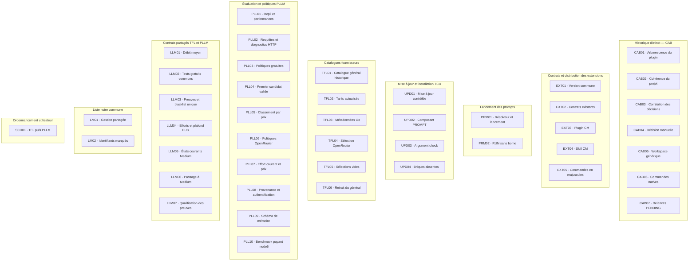
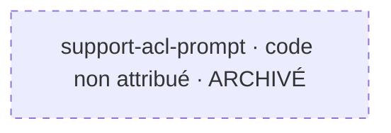

# DEVELOPMENT_MAP.md - Tools Codex

## 1. Périmètre et fraîcheur

Relevé : **28 octobre 2026**, Europe/Paris.
Plan **ACL-TOOLS-20261028-R1**, validé intégralement par le développeur dans la conversation ACL.
La cartographie était un squelette réduit à son titre ; le registre était absent.

Couverture vérifiée : **45 archives : 44 codées et 1 sans code**, référencés dans
[BATCH_CODES.md](openspec/BATCH_CODES.md). Les attributions sont des annotations
rétrospectives du 28 octobre 2026, pas les codes historiques d’origine.

Sources : [PROJECT.md](PROJECT.md), [TECHNICAL.md](TECHNICAL.md), [BUILD.md](BUILD.md),
[DEVOPS.md](DEVOPS.md), [configuration OpenSpec](openspec/config.yaml),
[spécifications courantes](openspec/specs/) et artefacts liés de chaque archive.
Les propositions justifient le rattachement individuel et leurs titres attestent les codes.

Faits vérifiés à cette date : présence des dossiers, titres codés, unicité, correspondances
et comptages documentaires. Les tâches et comptes rendus historiques sont des faits
documentés, sans nouvelle observation fonctionnelle. Aucune donnée sensible n’est
consultée pendant le relevé ACL initial ; aucun benchmark, test produit ni contrôle runtime
n’y a été rejoué. L’amendement SCM-ACL-R1 distingue ses propres tests hors ligne.

Les tâches historiques comportent **411 cases cochées sur 412**. Ce ratio documentaire n’est
pas un pourcentage fonctionnel. L’archivage est constaté par l’emplacement.
Les tâches, exigences, scénarios, preuves, statistiques et états des 44 archives historiques restent inchangés.

## 2. Vue d’ensemble

**A → B signifie : A dépend de B.** Un regroupement exprime une appartenance,
pas une dépendance. Aucune flèche n’est déduite d’un préfixe, numéro, thème ou date.
La vue générale présente les ensembles ; la vue détaillée et le registre couvrent les
44 lots. Les effectifs ne constituent pas de nouveaux codes.

| Famille | Responsabilité et rattachement | Nombre |
|---|---|---:|
| CAB | Pont d’approbation, contrôleur et distribution historiques | 7 |
| EXT | Contrats transverses, versionnement, présentation et distribution | 5 |
| PRM | Résolution et lancement des prompts depuis DEVOPS | 2 |
| UPD | Mise à jour et installation des briques par TCU | 4 |
| TFL | Collecte, sélection et publication des catalogues | 6 |
| PLL | Politiques, sélection, diagnostics et mémoire propres à PLLM | 10 |
| LLM | Mesures, efforts et preuves partagés TFL/PLLM | 7 |
| LM | Gestion et normalisation de la liste noire partagée | 2 |
| SCH | Ordonnancement conditionnel de TFL puis PLLM | 1 |
| **Total** | | **44** |

Les sections Organisation, Catalogue actuel, Lancement de prompts, Liste noire des modèles
et Rafraîchissement utilisateur planifié de PROJECT.md justifient les responsabilités.
TECHNICAL.md décrit les contrats partagés de mesure, d’admission et de preuves.
Les propositions liées précisent chaque rattachement. CAB reste un historique distinct.

## 3. Vue détaillée des lots

Tous les nœuds sont **archivés**, y compris CAB03 dont une tâche reste non cochée.
Les regroupements ne certifient aucune dépendance ; les prérequis opérationnels
et leur effet sur les phases concernées figurent en section 5.

## 4. Registre des lots et changes

État commun constaté le 28 octobre 2026 : **ARCHIVÉ**.
La classification de réalisabilité des changes actifs est sans objet pour ces archives.
Les ratios indiquent des cases cochées, pas des tâches revalidées par ACL.

Pour chaque entrée, réalisations et validations historiques restent dans les propositions,
tâches, conceptions et rapports du dossier lié. Aucune nouvelle validation fonctionnelle
n’est prononcée. Livraison, installation, intégration, qualification actuelle et activation
ne sont pas requalifiées par ACL. CAB03 conserve la validation E2E restante.

| Code | Identifiant technique et dossier | Rattachement et objet documenté | Cases cochées / total | Attribution | Source d’avancement |
|---|---|---|---:|---|---|
| CAB01 | [correct-plugin-layout-traceability](openspec/changes/archive/2026-09-11-correct-plugin-layout-traceability/) | CAB — Arborescence du plugin | 4/4 | [Proposition et titre](openspec/changes/archive/2026-09-11-correct-plugin-layout-traceability/proposal.md) | [Tâches](openspec/changes/archive/2026-09-11-correct-plugin-layout-traceability/tasks.md) |
| CAB02 | [establish-project-consistency](openspec/changes/archive/2026-09-11-establish-project-consistency/) | CAB — Cohérence du projet | 9/9 | [Proposition et titre](openspec/changes/archive/2026-09-11-establish-project-consistency/proposal.md) | [Tâches](openspec/changes/archive/2026-09-11-establish-project-consistency/tasks.md) |
| CAB03 | [fix-decision-request-id-correlation](openspec/changes/archive/2026-09-11-fix-decision-request-id-correlation/) | CAB — Corrélation des décisions | 4/5 | [Proposition et titre](openspec/changes/archive/2026-09-11-fix-decision-request-id-correlation/proposal.md) | [Tâches](openspec/changes/archive/2026-09-11-fix-decision-request-id-correlation/tasks.md) |
| CAB04 | [add-manual-cab-decision-mode](openspec/changes/archive/2026-09-15-add-manual-cab-decision-mode/) | CAB — Décision manuelle | 4/4 | [Proposition et titre](openspec/changes/archive/2026-09-15-add-manual-cab-decision-mode/proposal.md) | [Tâches](openspec/changes/archive/2026-09-15-add-manual-cab-decision-mode/tasks.md) |
| CAB05 | [allow-generic-controller-workspace](openspec/changes/archive/2026-09-15-allow-generic-controller-workspace/) | CAB — Workspace générique | 4/4 | [Proposition et titre](openspec/changes/archive/2026-09-15-allow-generic-controller-workspace/proposal.md) | [Tâches](openspec/changes/archive/2026-09-15-allow-generic-controller-workspace/tasks.md) |
| CAB06 | [fix-native-command-correlation](openspec/changes/archive/2026-09-15-fix-native-command-correlation/) | CAB — Commandes natives | 5/5 | [Proposition et titre](openspec/changes/archive/2026-09-15-fix-native-command-correlation/proposal.md) | [Tâches](openspec/changes/archive/2026-09-15-fix-native-command-correlation/tasks.md) |
| CAB07 | [add-pending-approval-controller-reminders](openspec/changes/archive/2026-09-18-add-pending-approval-controller-reminders/) | CAB — Relances PENDING | 6/6 | [Proposition et titre](openspec/changes/archive/2026-09-18-add-pending-approval-controller-reminders/proposal.md) | [Tâches](openspec/changes/archive/2026-09-18-add-pending-approval-controller-reminders/tasks.md) |
| EXT01 | [release-tools-codex-v0-2](openspec/changes/archive/2026-09-19-release-tools-codex-v0-2/) | EXT — Version commune | 4/4 | [Proposition et titre](openspec/changes/archive/2026-09-19-release-tools-codex-v0-2/proposal.md) | [Tâches](openspec/changes/archive/2026-09-19-release-tools-codex-v0-2/tasks.md) |
| EXT02 | [document-existing-extension-contracts](openspec/changes/archive/2026-10-10-document-existing-extension-contracts/) | EXT — Contrats existants | 21/21 | [Proposition et titre](openspec/changes/archive/2026-10-10-document-existing-extension-contracts/proposal.md) | [Tâches](openspec/changes/archive/2026-10-10-document-existing-extension-contracts/tasks.md) |
| EXT03 | [distribute-cm-plugin](openspec/changes/archive/2026-10-19-distribute-cm-plugin/) | EXT — Plugin CM | 11/11 | [Proposition et titre](openspec/changes/archive/2026-10-19-distribute-cm-plugin/proposal.md) | [Tâches](openspec/changes/archive/2026-10-19-distribute-cm-plugin/tasks.md) |
| EXT04 | [migrate-cm-to-skill](openspec/changes/archive/2026-10-19-migrate-cm-to-skill/) | EXT — Skill CM | 11/11 | [Proposition et titre](openspec/changes/archive/2026-10-19-migrate-cm-to-skill/proposal.md) | [Tâches](openspec/changes/archive/2026-10-19-migrate-cm-to-skill/tasks.md) |
| EXT05 | [uppercase-tools-codex-commands](openspec/changes/archive/2026-10-27-uppercase-tools-codex-commands/) | EXT — Commandes en majuscules | 5/5 | [Proposition et titre](openspec/changes/archive/2026-10-27-uppercase-tools-codex-commands/proposal.md) | [Tâches](openspec/changes/archive/2026-10-27-uppercase-tools-codex-commands/tasks.md) |
| LLM01 | [fix-buffered-stream-throughput](openspec/changes/archive/2026-10-25-fix-buffered-stream-throughput/) | LLM — Débit moyen | 14/14 | [Proposition et titre](openspec/changes/archive/2026-10-25-fix-buffered-stream-throughput/proposal.md) | [Tâches](openspec/changes/archive/2026-10-25-fix-buffered-stream-throughput/tasks.md) |
| LLM02 | [harmonize-free-model-performance](openspec/changes/archive/2026-10-25-harmonize-free-model-performance/) | LLM — Tests gratuits communs | 15/15 | [Proposition et titre](openspec/changes/archive/2026-10-25-harmonize-free-model-performance/proposal.md) | [Tâches](openspec/changes/archive/2026-10-25-harmonize-free-model-performance/tasks.md) |
| LLM03 | [fix-tfl-pllm-model-evidence-and-shared-blacklist](openspec/changes/archive/2026-10-26-fix-tfl-pllm-model-evidence-and-shared-blacklist/) | LLM — Preuves et blacklist unique | 10/10 | [Proposition et titre](openspec/changes/archive/2026-10-26-fix-tfl-pllm-model-evidence-and-shared-blacklist/proposal.md) | [Tâches](openspec/changes/archive/2026-10-26-fix-tfl-pllm-model-evidence-and-shared-blacklist/tasks.md) |
| LLM04 | [modify-tfl-pllm-reasoning-and-openrouter-eur-filter](openspec/changes/archive/2026-10-26-modify-tfl-pllm-reasoning-and-openrouter-eur-filter/) | LLM — Efforts et plafond EUR | 7/7 | [Proposition et titre](openspec/changes/archive/2026-10-26-modify-tfl-pllm-reasoning-and-openrouter-eur-filter/proposal.md) | [Tâches](openspec/changes/archive/2026-10-26-modify-tfl-pllm-reasoning-and-openrouter-eur-filter/tasks.md) |
| LLM05 | [converge-current-medium-effort](openspec/changes/archive/2026-10-27-converge-current-medium-effort/) | LLM — États courants Medium | 12/12 | [Proposition et titre](openspec/changes/archive/2026-10-27-converge-current-medium-effort/proposal.md) | [Tâches](openspec/changes/archive/2026-10-27-converge-current-medium-effort/tasks.md) |
| LLM06 | [switch-tfl-pllm-reasoning-to-medium](openspec/changes/archive/2026-10-27-switch-tfl-pllm-reasoning-to-medium/) | LLM — Passage à Medium | 8/8 | [Proposition et titre](openspec/changes/archive/2026-10-27-switch-tfl-pllm-reasoning-to-medium/proposal.md) | [Tâches](openspec/changes/archive/2026-10-27-switch-tfl-pllm-reasoning-to-medium/tasks.md) |
| LLM07 | [qualify-pllm-catalog-evidence-0-7-20](openspec/changes/archive/2026-10-28-qualify-pllm-catalog-evidence-0-7-20/) | LLM — Qualification des preuves | 15/15 | [Proposition et titre](openspec/changes/archive/2026-10-28-qualify-pllm-catalog-evidence-0-7-20/proposal.md) | [Tâches](openspec/changes/archive/2026-10-28-qualify-pllm-catalog-evidence-0-7-20/tasks.md) |
| LM01 | [add-lm-shared-model-blacklist](openspec/changes/archive/2026-10-26-add-lm-shared-model-blacklist/) | LM — Gestion partagée | 11/11 | [Proposition et titre](openspec/changes/archive/2026-10-26-add-lm-shared-model-blacklist/proposal.md) | [Tâches](openspec/changes/archive/2026-10-26-add-lm-shared-model-blacklist/tasks.md) |
| LM02 | [fix-lm-openrouter-tilde-identifiers](openspec/changes/archive/2026-10-26-fix-lm-openrouter-tilde-identifiers/) | LM — Identifiants marqués | 8/8 | [Proposition et titre](openspec/changes/archive/2026-10-26-fix-lm-openrouter-tilde-identifiers/proposal.md) | [Tâches](openspec/changes/archive/2026-10-26-fix-lm-openrouter-tilde-identifiers/tasks.md) |
| PLL01 | [add-pllm-free-fallback-auth-diagnostics](openspec/changes/archive/2026-10-25-add-pllm-free-fallback-auth-diagnostics/) | PLL — Repli et performances | 14/14 | [Proposition et titre](openspec/changes/archive/2026-10-25-add-pllm-free-fallback-auth-diagnostics/proposal.md) | [Tâches](openspec/changes/archive/2026-10-25-add-pllm-free-fallback-auth-diagnostics/tasks.md) |
| PLL02 | [fix-pllm-request-and-rate-limit-diagnostics](openspec/changes/archive/2026-10-25-fix-pllm-request-and-rate-limit-diagnostics/) | PLL — Requêtes et diagnostics HTTP | 13/13 | [Proposition et titre](openspec/changes/archive/2026-10-25-fix-pllm-request-and-rate-limit-diagnostics/proposal.md) | [Tâches](openspec/changes/archive/2026-10-25-fix-pllm-request-and-rate-limit-diagnostics/tasks.md) |
| PLL03 | [split-pllm-free-modes](openspec/changes/archive/2026-10-25-split-pllm-free-modes/) | PLL — Politiques gratuites | 14/14 | [Proposition et titre](openspec/changes/archive/2026-10-25-split-pllm-free-modes/proposal.md) | [Tâches](openspec/changes/archive/2026-10-25-split-pllm-free-modes/tasks.md) |
| PLL04 | [optimize-pllm-first-valid-selection](openspec/changes/archive/2026-10-26-optimize-pllm-first-valid-selection/) | PLL — Premier candidat valide | 7/7 | [Proposition et titre](openspec/changes/archive/2026-10-26-optimize-pllm-first-valid-selection/proposal.md) | [Tâches](openspec/changes/archive/2026-10-26-optimize-pllm-first-valid-selection/tasks.md) |
| PLL05 | [prioritize-paid-model-price](openspec/changes/archive/2026-10-26-prioritize-paid-model-price/) | PLL — Classement par prix | 15/15 | [Proposition et titre](openspec/changes/archive/2026-10-26-prioritize-paid-model-price/proposal.md) | [Tâches](openspec/changes/archive/2026-10-26-prioritize-paid-model-price/tasks.md) |
| PLL06 | [add-openrouter-catalog-and-free-policy](openspec/changes/archive/2026-10-27-add-openrouter-catalog-and-free-policy/) | PLL — Politiques OpenRouter | 8/8 | [Proposition et titre](openspec/changes/archive/2026-10-27-add-openrouter-catalog-and-free-policy/proposal.md) | [Tâches](openspec/changes/archive/2026-10-27-add-openrouter-catalog-and-free-policy/tasks.md) |
| PLL07 | [pllm-current-medium-and-openrouter-price-normalization](openspec/changes/archive/2026-10-27-pllm-current-medium-and-openrouter-price-normalization/) | PLL — Effort courant et prix | 5/5 | [Proposition et titre](openspec/changes/archive/2026-10-27-pllm-current-medium-and-openrouter-price-normalization/proposal.md) | [Tâches](openspec/changes/archive/2026-10-27-pllm-current-medium-and-openrouter-price-normalization/tasks.md) |
| PLL08 | [fix-pllm-catalog-provenance-and-auth-diagnostics](openspec/changes/archive/2026-10-28-fix-pllm-catalog-provenance-and-auth-diagnostics/) | PLL — Provenance et authentification | 7/7 | [Proposition et titre](openspec/changes/archive/2026-10-28-fix-pllm-catalog-provenance-and-auth-diagnostics/proposal.md) | [Tâches](openspec/changes/archive/2026-10-28-fix-pllm-catalog-provenance-and-auth-diagnostics/tasks.md) |
| PLL09 | [fix-pllm-performance-memory-schema](openspec/changes/archive/2026-10-28-fix-pllm-performance-memory-schema/) | PLL — Schéma de mémoire | 6/6 | [Proposition et titre](openspec/changes/archive/2026-10-28-fix-pllm-performance-memory-schema/proposal.md) | [Tâches](openspec/changes/archive/2026-10-28-fix-pllm-performance-memory-schema/tasks.md) |
| PLL10 | [restore-mode5-paid-benchmark](openspec/changes/archive/2026-10-28-restore-mode5-paid-benchmark/) | PLL — Benchmark payant mode5 | 6/6 | [Proposition et titre](openspec/changes/archive/2026-10-28-restore-mode5-paid-benchmark/proposal.md) | [Tâches](openspec/changes/archive/2026-10-28-restore-mode5-paid-benchmark/tasks.md) |
| PRM01 | [add-prompt-dispatcher](openspec/changes/archive/2026-10-19-add-prompt-dispatcher/) | PRM — Résolveur et lancement | 11/11 | [Proposition et titre](openspec/changes/archive/2026-10-19-add-prompt-dispatcher/proposal.md) | [Tâches](openspec/changes/archive/2026-10-19-add-prompt-dispatcher/tasks.md) |
| PRM02 | [unbound-prompt-runs](openspec/changes/archive/2026-10-28-unbound-prompt-runs/) | PRM — RUN sans borne | 5/5 | [Proposition et titre](openspec/changes/archive/2026-10-28-unbound-prompt-runs/proposal.md) | [Tâches](openspec/changes/archive/2026-10-28-unbound-prompt-runs/tasks.md) |
| SCH01 | [add-user-llm-refresh-schedule](openspec/changes/archive/2026-10-26-add-user-llm-refresh-schedule/) | SCH — TFL puis PLLM | 12/12 | [Proposition et titre](openspec/changes/archive/2026-10-26-add-user-llm-refresh-schedule/proposal.md) | [Tâches](openspec/changes/archive/2026-10-26-add-user-llm-refresh-schedule/tasks.md) |
| TFL01 | [add-general-opencode-catalog-to-tfl](openspec/changes/archive/2026-10-25-add-general-opencode-catalog-to-tfl/) | TFL — Catalogue général historique | 13/13 | [Proposition et titre](openspec/changes/archive/2026-10-25-add-general-opencode-catalog-to-tfl/proposal.md) | [Tâches](openspec/changes/archive/2026-10-25-add-general-opencode-catalog-to-tfl/tasks.md) |
| TFL02 | [add-tfl-live-provider-pricing](openspec/changes/archive/2026-10-25-add-tfl-live-provider-pricing/) | TFL — Tarifs actualisés | 12/12 | [Proposition et titre](openspec/changes/archive/2026-10-25-add-tfl-live-provider-pricing/proposal.md) | [Tâches](openspec/changes/archive/2026-10-25-add-tfl-live-provider-pricing/tasks.md) |
| TFL03 | [collect-go-modalities-and-routing-dynamically](openspec/changes/archive/2026-10-25-collect-go-modalities-and-routing-dynamically/) | TFL — Métadonnées Go | 13/13 | [Proposition et titre](openspec/changes/archive/2026-10-25-collect-go-modalities-and-routing-dynamically/proposal.md) | [Tâches](openspec/changes/archive/2026-10-25-collect-go-modalities-and-routing-dynamically/tasks.md) |
| TFL04 | [select-openrouter-models-by-live-filters](openspec/changes/archive/2026-10-25-select-openrouter-models-by-live-filters/) | TFL — Sélection OpenRouter | 11/11 | [Proposition et titre](openspec/changes/archive/2026-10-25-select-openrouter-models-by-live-filters/proposal.md) | [Tâches](openspec/changes/archive/2026-10-25-select-openrouter-models-by-live-filters/tasks.md) |
| TFL05 | [allow-empty-tfl-provider-selections](openspec/changes/archive/2026-10-26-allow-empty-tfl-provider-selections/) | TFL — Sélections vides | 6/6 | [Proposition et titre](openspec/changes/archive/2026-10-26-allow-empty-tfl-provider-selections/proposal.md) | [Tâches](openspec/changes/archive/2026-10-26-allow-empty-tfl-provider-selections/tasks.md) |
| TFL06 | [remove-general-opencode-tfl](openspec/changes/archive/2026-10-26-remove-general-opencode-tfl/) | TFL — Retrait du général | 11/11 | [Proposition et titre](openspec/changes/archive/2026-10-26-remove-general-opencode-tfl/proposal.md) | [Tâches](openspec/changes/archive/2026-10-26-remove-general-opencode-tfl/tasks.md) |
| UPD01 | [add-tcu-updater](openspec/changes/archive/2026-10-19-add-tcu-updater/) | UPD — Mise à jour contrôlée | 11/11 | [Proposition et titre](openspec/changes/archive/2026-10-19-add-tcu-updater/proposal.md) | [Tâches](openspec/changes/archive/2026-10-19-add-tcu-updater/tasks.md) |
| UPD02 | [manage-prompt-component](openspec/changes/archive/2026-10-19-manage-prompt-component/) | UPD — Composant PROMPT | 10/10 | [Proposition et titre](openspec/changes/archive/2026-10-19-manage-prompt-component/proposal.md) | [Tâches](openspec/changes/archive/2026-10-19-manage-prompt-component/tasks.md) |
| UPD03 | [tcu-plain-check](openspec/changes/archive/2026-10-19-tcu-plain-check/) | UPD — Argument check | 6/6 | [Proposition et titre](openspec/changes/archive/2026-10-19-tcu-plain-check/proposal.md) | [Tâches](openspec/changes/archive/2026-10-19-tcu-plain-check/tasks.md) |
| UPD04 | [install-missing-tools-codex-components](openspec/changes/archive/2026-10-28-install-missing-tools-codex-components/) | UPD — Briques absentes | 7/7 | [Proposition et titre](openspec/changes/archive/2026-10-28-install-missing-tools-codex-components/proposal.md) | [Tâches](openspec/changes/archive/2026-10-28-install-missing-tools-codex-components/tasks.md) |

### Entrées provisoires sans code

Amendement SCM-ACL-R1 du 28 octobre 2026 ; aucun code attribué ni réservé.

| Repère | Identifiant et source | État et avancement | Réalisabilité | Livraison et activation |
|---|---|---|---|---|
| code non attribué | [support-acl-prompt](openspec/changes/archive/2026-10-28-support-acl-prompt/proposal.md) | ARCHIVÉ ; 5/5 tâches cochées, [tâches](openspec/changes/archive/2026-10-28-support-acl-prompt/tasks.md) | Sans objet : archive vérifiée ; tests ciblés 22/22 et suite complète 368/368 sur Python 3.13 et 3.14 ; contrôles documentaires et OpenSpec standard/strict réussis | Installation utilisateur et activation non effectuées |

Le pointillé identifie une entrée provisoire sans code. Ce change relève du lancement des prompts d’après sa proposition. Aucun lien de dépendance entre lots n’est ajouté ; aucun service externe n’est requis pour sa qualification hors ligne.

## 5. Registre des dépendances

Relations directes documentées, limitées aux phases indiquées. Leur satisfaction actuelle
est NON VÉRIFIÉE, sans assimilation à un blocage actuel démontré. Aucune sonde runtime
n’est déclenchée. Les codes renvoient aux identifiants techniques exacts du registre.

| Lot dépendant | Prérequis interne ou externe | Nature et phase affectée | Condition attendue | Satisfaction actuelle | Source et preuve |
|---|---|---|---|---|---|
| CAB03 | Environnement externe OpenCode/CAB et approbation antérieure | Test E2E 2.3 | Environnement disponible, approbation antérieure réconciliée, puis test observé | NON VÉRIFIÉE | [Tâche 2.3](openspec/changes/archive/2026-09-11-fix-decision-request-id-correlation/tasks.md) : blocage historique ; case non cochée vérifiée le 28 octobre 2026 |
| SCH01 | Paquets installés, session Codex, systemd utilisateur et confiance native des hooks | Installation, activation et exécution planifiée | Installation reconnue et conditions du runner satisfaites, avec preuves propres à l’activation | NON VÉRIFIÉE | [Conception](openspec/changes/archive/2026-10-26-add-user-llm-refresh-schedule/design.md) ; [BUILD.md](BUILD.md) ; conditions relues le 28 octobre 2026 |
| SCH01 | Catalogue TFL frais transmis à PLLM | Étape PLLM de la séquence planifiée | Publication TFL réussie et catalogue frais explicitement transmis | NON VÉRIFIÉE | [Exécution et quota](openspec/changes/archive/2026-10-26-add-user-llm-refresh-schedule/design.md) ; condition relue le 28 octobre 2026 |
| PLL08, LLM07, PLL10 | Catalogue, comptes et services fournisseurs externes | Évaluations réelles, génération et qualification | Données admissibles et contrôles de ressources/génération effectivement observés | NON VÉRIFIÉE | [PLL08](openspec/changes/archive/2026-10-28-fix-pllm-catalog-provenance-and-auth-diagnostics/proposal.md) ; [LLM07](openspec/changes/archive/2026-10-28-qualify-pllm-catalog-evidence-0-7-20/proposal.md) ; [PLL10](openspec/changes/archive/2026-10-28-restore-mode5-paid-benchmark/proposal.md) ; [TECHNICAL.md](TECHNICAL.md), [BUILD.md](BUILD.md) ; périmètres relus le 28 octobre 2026 |

Une collecte réussie ne vaut pas génération réussie ; sources et tests isolés ne valent
pas installation ou activation. Une interface commune n’est pas automatiquement bloquante.

Aucun cycle entre lots n’est établi dans les relations proposées ; aucune dépendance
transitive entre archives n’est affirmée. L’absence de flèche ne prouve pas l’indépendance.
Les relations futures devront préciser leur source et leur preuve pour la phase concernée.

## 6. Orientation de la progression

Aucun change actif après archivage vérifié de support-acl-prompt, cible de SCM-ACL-R1.
Les tests ciblés, la validation globale et les contrôles documentaires sont réussis.
Le nouveau change archivé reste sans code ; exécuter ultérieurement ACL pour son attribution. Les archives constituent des références documentaires ;
leur présence et leurs cases cochées ne prouvent pas la disponibilité actuelle des composants.
Une future sélection devra inventorier les changes alors actifs et revérifier leurs prérequis.

Respecter d’abord le périmètre et les décisions du développeur ; favoriser ensuite les unités
aux prérequis vérifiés, le faible nombre et la faible difficulté des dépendances restantes,
l’effet de déblocage direct puis transitif et une progression cohérente vérifiable.
L’effort et l’incertitude ne sont pas chiffrés faute d’estimations comparables établies ici.
Un futur change absent de cette synthèse datée n’est pas réputé réalisable ou sans dépendance.

La cartographie ne lance aucun prompt, ne rouvre aucune archive, ne remplace aucune validation
et ne dispense pas d’un BLOCKERS.md requis. La limite E2E de CAB03 n’est pas une recommandation
de réouverture.

## 7. Incertitudes, anomalies et limites

- CAB03 conserve la tâche 2.3 non cochée : test E2E historiquement empêché par une approbation antérieure pendante. Son état runtime actuel est NON VÉRIFIÉ ; aucune sonde n’a été lancée.
- CAB05 ne possède pas de design.md ; sa proposition et ses tâches permettent son identification.
- Neuf archives n’ont pas de STATISTICS.md : CAB01 à CAB07, EXT01 et LLM03. ACL ne crée ni ne régénère de statistiques historiques.
- CAB01 à CAB07 constituent un historique distinct du catalogue courant ; leur provenance reste non qualifiée selon PROJECT.md.
- Aucun BLOCKER.md ni BLOCKERS.md n’a été trouvé dans les changes examinés.

Les anciens contrats restent historiques : TFL01 décrit le catalogue général ensuite
retiré par TFL06 ; les efforts de raisonnement ont évolué jusqu’aux contrats Medium ;
PLL06 décrit un mode5 sans génération alors que PLL10 rétablit son benchmark payant.
Ces successions n’impliquent ni réécriture des archives ni dépendance entre leurs lots.
Les [spécifications courantes](openspec/specs/) priment pour le comportement actuel.

Le résolveur PROMPT local ne reconnaît pas encore ACL, pourtant présent dans l’index déclaré
par DEVOPS.md. Ce constat n’invalide pas l’invocation directe validée et n’autorise pas sa correction.

Les hypothèses de disponibilité actuelle, de dépendance fondée sur la seule succession des
releases ou d’indépendance liée à l’absence de flèche sont exclues des décisions automatiques.
Les installations et activations actuelles non recontrôlées restent non vérifiées.

Contrôles d’application : couverture des 44 titres et des deux registres, unicité, liens,
conservation hors annotations, UTF-8/LF et comptages. Les validations OpenSpec globales standard
et stricte portent sur les spécifications courantes ; elles ne couvrent pas les archives.
Le contrôle natif des tâches archivées conserve l’échec historique CAB03 (4/5).
Les résultats d’exécution et les limites du contrôle Mermaid sont restitués dans la conversation ACL.

## 8. Légende

- Code de lot : repère documentaire stable distinct de l’identifiant, du dossier, d’un RUN,
  d’une tâche ou d’un scénario.
- Familles : CAB historique distinct ; EXT contrats/distribution ; PRM prompts ; UPD TCU ;
  TFL catalogues ; PLL évaluation PLLM ; LLM contrats partagés ; LM liste noire ; SCH ordonnancement.
  Les ensembles expriment cette appartenance documentée.
- ARCHIVÉ : emplacement constaté, sans validation fonctionnelle, livraison ou activation implicite.
- Cases cochées / total : indicateur documentaire, sans pourcentage fonctionnel ni revalidation.
- Fait vérifié : observation documentaire confirmée au relevé daté ; fait documenté :
  information décrite dans une source ; hypothèse à confirmer : exclue des décisions automatiques.
- SATISFAITE : condition précise démontrée ; NON SATISFAITE : empêchement actuel sur preuve ;
  NON VÉRIFIÉE : preuves actuelles insuffisantes. Seul ce dernier état qualifie ici les prérequis runtime.
- Pour les futurs changes actifs : RÉALISABLE signifie prérequis vérifiés ; PARTIELLEMENT RÉALISABLE,
  unités indépendantes identifiées ; BLOQUÉ, aucune unité restante possible sur preuves ;
  À VÉRIFIER, informations insuffisantes. Aucun de ces états n’est attribué automatiquement aux archives.
- Rectangles : code et libellé court ; les couleurs ne portent aucune information nécessaire.
  Aucun repère provisoire sans code n’est nécessaire dans le présent inventaire.
- Une dépendance précise sa nature, sa phase, sa condition et sa source.
  **A → B signifie que A dépend de B** ; la flèche va du dépendant vers son prérequis.
  L’absence de flèche ne signifie pas absence de dépendance.
